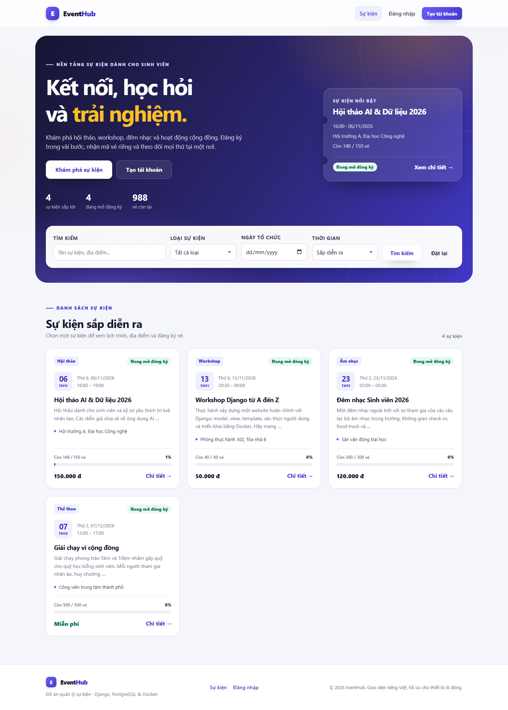
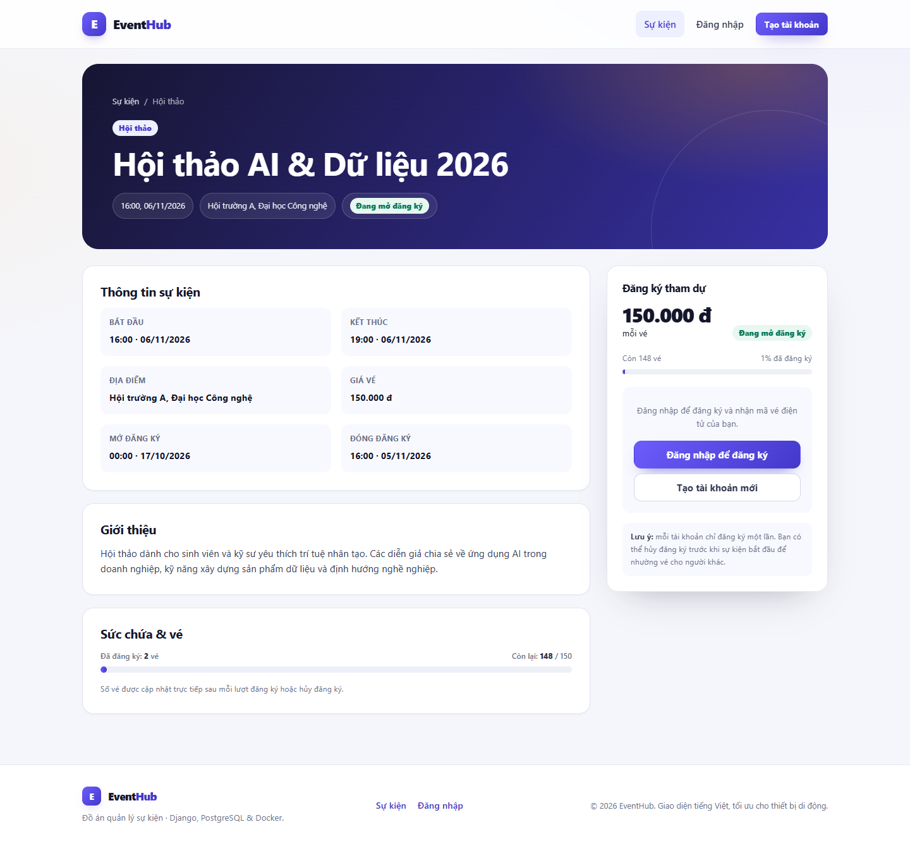
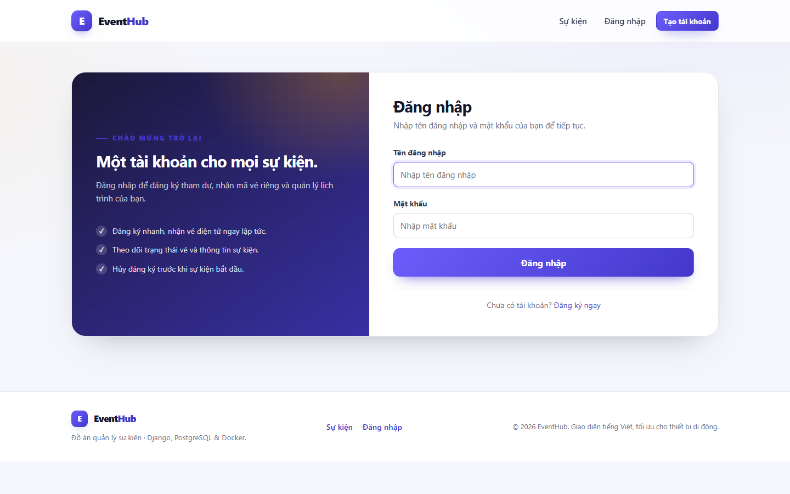
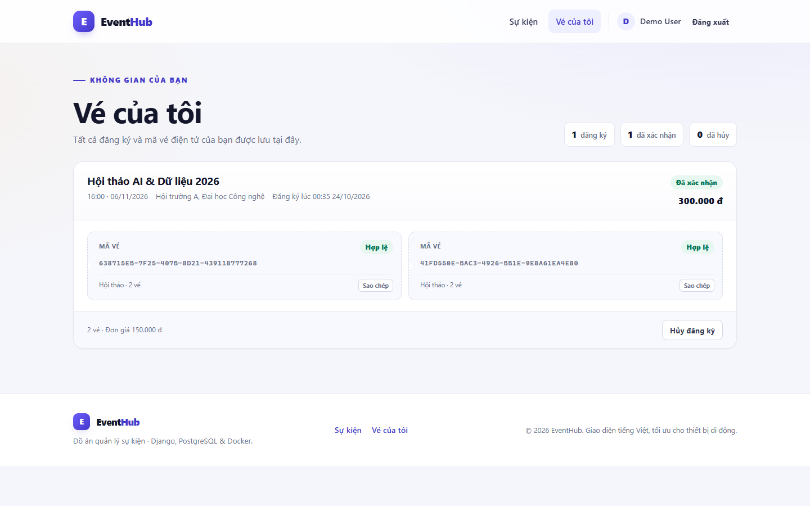
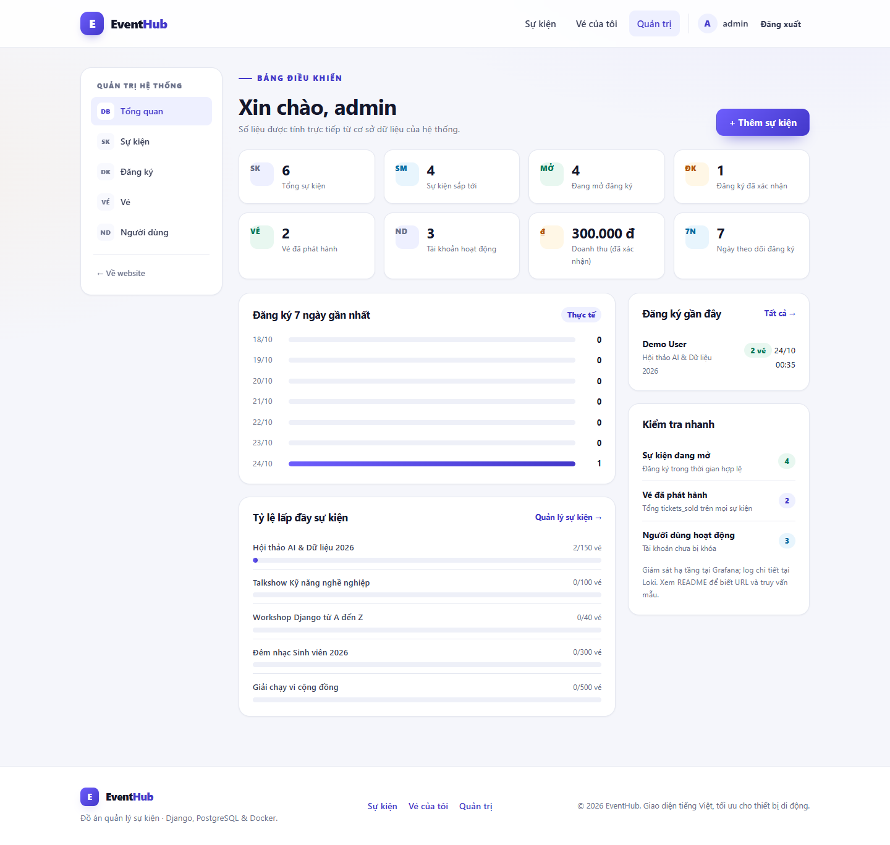
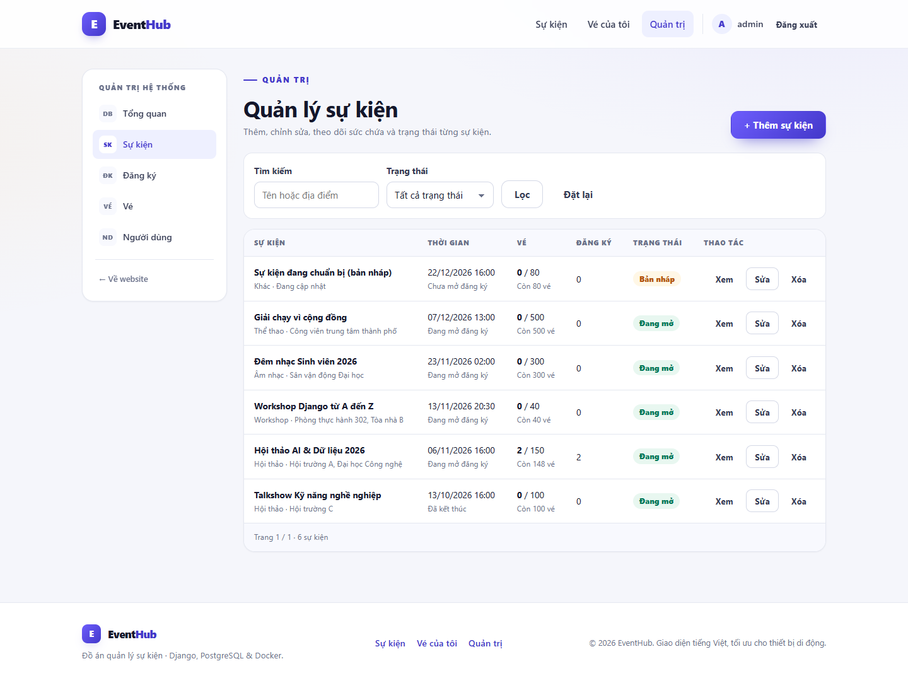
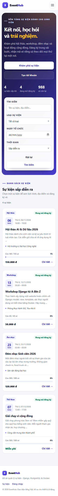

# EventHub – Hệ thống quản lý sự kiện

Website quản lý sự kiện dành cho sinh viên, giao diện tiếng Việt, xây dựng bằng
**Django + PostgreSQL**, đóng gói bằng **Docker Compose**, có **Nginx** làm
reverse proxy và bộ giám sát **Prometheus + Grafana + Loki/Alloy**.

Người dùng có thể tìm kiếm sự kiện, đăng ký nhận vé điện tử, xem và hủy đăng ký.
Quản trị viên có dashboard thống kê thật từ cơ sở dữ liệu, quản lý sự kiện,
người dùng, đăng ký, vé và check-in.

> Đây là đồ án học tập. Các thông số giám sát đều lấy từ ứng dụng/hạ tầng thật,
> không có số liệu mô phỏng.

---

## Mục lục

1. [Tính năng](#1-tính-năng)
2. [Kiến trúc và công nghệ](#2-kiến-trúc-và-công-nghệ)
3. [Cấu trúc thư mục](#3-cấu-trúc-thư-mục)
4. [Chạy nhanh bằng Docker Compose](#4-chạy-nhanh-bằng-docker-compose)
5. [Chạy local bằng SQLite](#5-chạy-local-bằng-sqlite)
6. [Biến môi trường](#6-biến-môi-trường)
7. [Địa chỉ truy cập](#7-địa-chỉ-truy-cập)
8. [Cơ sở dữ liệu và migrate](#8-cơ-sở-dữ-liệu-và-migrate)
9. [Quy tắc nghiệp vụ](#9-quy-tắc-nghiệp-vụ)
10. [Kiểm thử](#10-kiểm-thử)
11. [Giám sát với Prometheus và Grafana](#11-giám-sát-với-prometheus-và-grafana)
12. [Log với Loki và LogQL](#12-log-với-loki-và-logql)
13. [HTTPS và tên miền](#13-https-và-tên-miền)
14. [Bảo mật](#14-bảo-mật)
15. [Sao lưu và khôi phục](#15-sao-lưu-và-khôi-phục)
16. [Xử lý sự cố](#16-xử-lý-sự-cố)
17. [Ảnh minh chứng](#17-ảnh-minh-chứng)
18. [Giới hạn và hướng phát triển](#18-giới-hạn-và-hướng-phát-triển)

---

## 1. Tính năng

### Người dùng

- Xem danh sách sự kiện đã công bố, sự kiện nổi bật, thống kê vé còn lại.
- Tìm kiếm theo tên/mô tả/địa điểm; lọc theo loại, ngày, sắp diễn ra/đã kết thúc.
- Phân trang, giao diện responsive cho điện thoại và máy tính.
- Đăng ký tài khoản, đăng nhập, đăng xuất.
- Đăng ký một hoặc nhiều vé cho một sự kiện; nhận mã vé điện tử duy nhất.
- Xem “Vé của tôi”: trạng thái đăng ký, trạng thái từng vé, mã vé, tổng tiền.
- Hủy đăng ký trước khi sự kiện bắt đầu; vé tương ứng chuyển sang “Đã hủy”.

### Quản trị viên (`is_staff`)

- Dashboard với số liệu thật: tổng sự kiện, sự kiện sắp tới, đang mở đăng ký,
  đăng ký đã xác nhận, vé đã phát hành, người dùng hoạt động, doanh thu.
- Biểu đồ đăng ký 7 ngày gần nhất và tỷ lệ lấp đầy từng sự kiện.
- CRUD sự kiện; chặn xóa sự kiện đã có đăng ký để bảo toàn dữ liệu.
- Danh sách người dùng, khóa/mở khóa tài khoản (không tự khóa chính mình).
- Danh sách đăng ký, hủy đăng ký thay người dùng.
- Danh sách vé, check-in vé (chỉ vé hợp lệ, chưa dùng, sự kiện chưa hủy).
- Django admin tại `/django-admin/` cho các thao tác cấp thấp.

### Hạ tầng

- Docker Compose gồm Django/Gunicorn, PostgreSQL, Nginx, pgAdmin, Prometheus,
  Grafana, Loki, Alloy, node-exporter, cAdvisor, postgres-exporter.
- Healthcheck, volume lưu dữ liệu, image ghim phiên bản, container web chạy
  không phải root.
- Prometheus scrape metrics thật của Django, máy chủ, container và PostgreSQL.
- Loki nhận log JSON từ Django/Nginx qua Alloy; Nginx **không ghi query string**.

---

## 2. Kiến trúc và công nghệ

```
                        Internet / trình duyệt
                                  │
                          HTTP :8080 (hoặc 80/443)
                                  │
                        ┌─────────▼─────────┐
                        │      Nginx        │  security headers, rate limit,
                        │  reverse proxy    │  static/media, JSON access log
                        └────┬─────────┬────┘
                             │         │
             /static, /media │         │ proxy_pass
                             │         ▼
                             │   ┌──────────────┐
                             │   │ Django 5.2   │──> /metrics (nội bộ)
                             │   │ Gunicorn     │
                             │   └──────┬───────┘
                             │          │
                             │   ┌──────▼───────┐
                             │   │ PostgreSQL   │
                             │   └──────┬───────┘
                             │          │
                     volume static   postgres-exporter
                                        │
   ┌──────────────┬──────────────┬──────┴───────┬──────────────┐
   │ Prometheus   │   Grafana    │     Loki     │    Alloy     │
   │  (metrics)   │ (dashboard)  │   (logs)     │ (Docker log) │
   └──────────────┴──────────────┴──────────────┴──────────────┘
        node-exporter, cAdvisor ──────────────┘
```

| Thành phần | Phiên bản | Vai trò |
|---|---|---|
| Python | 3.12.12 | Runtime |
| Django | 5.2.18 LTS | Web framework |
| PostgreSQL | 17.11-alpine | Cơ sở dữ liệu chính |
| Gunicorn | 23.0.0 | WSGI server |
| Nginx | 1.30.6-alpine | Reverse proxy, static, bảo mật |
| pgAdmin | 9.18.0 | Quản trị PostgreSQL |
| Prometheus | v3.15.1 | Thu thập metrics |
| Grafana | 13.2.4 | Dashboard giám sát |
| Loki | 3.7.9 | Lưu trữ log |
| Alloy | v1.21.2 | Thu log Docker → Loki |
| node-exporter | v1.12.1 | Metrics máy chủ |
| cAdvisor | v0.55.1 | Metrics container |
| postgres-exporter | v0.20.1 | Metrics PostgreSQL |

Thư viện Python: `psycopg[binary]`, `django-prometheus`, `python-dotenv`
(xem `requirements.txt`).

---

## 3. Cấu trúc thư mục

```
.
├── accounts/                 # User tùy chỉnh, đăng ký/đăng nhập
├── config/                   # settings, URL gốc, logging JSON, healthcheck
├── dashboard/                # Dashboard và các màn hình quản trị
├── events/                   # Event, Registration, Ticket, nghiệp vụ, test
│   ├── management/commands/  # seed_events
│   ├── migrations/
│   ├── templatetags/         # bộ lọc hiển thị tiền tệ
│   └── tests/
├── templates/                # Template tiếng Việt
├── static/                   # CSS, JS, favicon
├── nginx/
│   ├── nginx.conf            # nginx.conf chính, chỉ log JSON
│   ├── conf.d/00-shared.conf # log_format, rate limit, upstream
│   ├── conf.d/default.conf   # server HTTP :80
│   └── https.conf.example    # mẫu HTTPS (chưa bật)
├── monitoring/
│   ├── prometheus/           # scrape config
│   ├── grafana/              # datasource + dashboard provisioning
│   ├── loki/                 # Loki config
│   └── alloy/                # thu log Docker
├── docker/entrypoint.sh      # chờ DB, migrate, collectstatic, gunicorn
├── docs/                     # checklist bảo mật, LogQL, ảnh minh chứng
├── Dockerfile
├── docker-compose.yml
├── requirements.txt
├── .env.example
└── manage.py
```

---

## 4. Chạy nhanh bằng Docker Compose

### 4.1. Yêu cầu

- Docker Engine/Desktop có Docker Compose v2 (`docker compose version`).
- Khuyến nghị cấp ít nhất 4 GB RAM cho toàn stack.
- Cổng `8080` còn trống (có thể đổi bằng `HTTP_PORT`).

### 4.2. Tạo file môi trường

Windows PowerShell:

```powershell
Copy-Item .env.example .env
python -c "import secrets; print(secrets.token_urlsafe(50))"
```

Linux/macOS:

```bash
cp .env.example .env
python3 -c "import secrets; print(secrets.token_urlsafe(50))"
```

Mở `.env` và thay **toàn bộ** giá trị mẫu, tối thiểu:

- `DJANGO_SECRET_KEY` – chuỗi ngẫu nhiên vừa tạo (≥ 32 ký tự).
- `POSTGRES_PASSWORD` – mật khẩu mạnh.
- `PGADMIN_DEFAULT_PASSWORD` – mật khẩu mạnh.
- `GF_SECURITY_ADMIN_PASSWORD` – mật khẩu mạnh.

> Ứng dụng sẽ **từ chối khởi động** nếu `DJANGO_DEBUG=False` mà
> `DJANGO_SECRET_KEY` vẫn là giá trị mẫu hoặc ngắn hơn 32 ký tự.

### 4.3. Khởi động

```bash
docker compose up -d --build
docker compose ps
```

Lần chạy đầu, container `web` sẽ tự động:

1. Chờ PostgreSQL sẵn sàng.
2. Chạy `python manage.py migrate`.
3. Chạy `collectstatic`.
4. Khởi động Gunicorn.

Xem log:

```bash
docker compose logs -f web
docker compose logs -f nginx
```

### 4.4. Tạo tài khoản quản trị và dữ liệu mẫu

```bash
docker compose exec web python manage.py createsuperuser
docker compose exec web python manage.py seed_events
```

`seed_events` là lệnh idempotent: chỉ tạo các sự kiện mẫu chưa tồn tại (theo
slug), không tạo tài khoản hay mật khẩu.

Mở http://localhost:8080.

### 4.5. Dừng và xóa

```bash
docker compose stop            # dừng, giữ dữ liệu
docker compose down            # xóa container, giữ volume
docker compose down -v         # XÓA CẢ DỮ LIỆU trong volume
```

---

## 5. Chạy local bằng SQLite

Chế độ này chỉ để phát triển giao diện/nghiệp vụ nhanh, **không dùng cho
production** vì SQLite không kiểm chứng được khóa dòng chống oversell.

```powershell
python -m venv .venv
.\.venv\Scripts\Activate.ps1
python -m pip install -r requirements.txt

Copy-Item .env.example .env
# Sửa .env:
#   DJANGO_DEBUG=True
#   DJANGO_SECRET_KEY=<chuỗi ngẫu nhiên>
#   (không đặt DB_ENGINE=postgres)

python manage.py migrate
python manage.py seed_events
python manage.py createsuperuser
python manage.py runserver
```

Mở http://127.0.0.1:8000.

Linux/macOS dùng `python3 -m venv .venv` và `source .venv/bin/activate`.

---

## 6. Biến môi trường

Các biến chính trong `.env` (xem đầy đủ ở `.env.example`):

| Biến | Mặc định | Ý nghĩa |
|---|---|---|
| `DJANGO_DEBUG` | `False` | Bật/tắt DEBUG. Production luôn để `False`. |
| `DJANGO_SECRET_KEY` | – | Khóa bí mật Django, bắt buộc khi DEBUG=False. |
| `DJANGO_ALLOWED_HOSTS` | `localhost,127.0.0.1,[::1],web` | Host được phép, phân tách bằng dấu phẩy (`web` để Prometheus scrape nội bộ). |
| `DJANGO_CSRF_TRUSTED_ORIGINS` | `http://localhost:8080,...` | Origin tin cậy cho CSRF (kèm scheme). |
| `DJANGO_LOG_LEVEL` | `INFO` | Mức log. |
| `DJANGO_SESSION_AGE` | `28800` | Thời hạn session (giây). |
| `DJANGO_SECURE_COOKIES` | `False` | Cookie `Secure`, chỉ bật khi HTTPS. |
| `DJANGO_SSL_REDIRECT` | `False` | Chuyển HTTP → HTTPS, chỉ bật khi HTTPS. |
| `DJANGO_HSTS_SECONDS` | `0` | HSTS; bật sau khi HTTPS ổn định. |
| `DJANGO_HSTS_INCLUDE_SUBDOMAINS` | `False` | HSTS cho subdomain. |
| `DJANGO_HSTS_PRELOAD` | `False` | Đăng ký HSTS preload. |
| `POSTGRES_DB` | `event_db` | Tên database. |
| `POSTGRES_USER` | `event_user` | User database. |
| `POSTGRES_PASSWORD` | – | Mật khẩu database. |
| `DB_ENGINE` | `sqlite` | Compose ép `postgres`; local có thể để trống. |
| `POSTGRES_HOST` | `db` | Compose ép `db`. |
| `POSTGRES_PORT` | `5432` | Cổng PostgreSQL. |
| `DB_CONN_MAX_AGE` | `60` | Thời gian giữ kết nối DB (giây). |
| `HTTP_PORT` | `8080` | Cổng public của website. |
| `PGADMIN_PORT` | `5050` | Cổng pgAdmin (chỉ 127.0.0.1). |
| `PROMETHEUS_PORT` | `9090` | Cổng Prometheus (chỉ 127.0.0.1). |
| `GRAFANA_PORT` | `3000` | Cổng Grafana (chỉ 127.0.0.1). |
| `LOKI_PORT` | `3100` | Cổng Loki (chỉ 127.0.0.1). |
| `PGADMIN_DEFAULT_EMAIL` | – | Email đăng nhập pgAdmin. |
| `PGADMIN_DEFAULT_PASSWORD` | – | Mật khẩu pgAdmin. |
| `GF_SECURITY_ADMIN_USER` | `admin` | User Grafana. |
| `GF_SECURITY_ADMIN_PASSWORD` | – | Mật khẩu Grafana. |
| `GUNICORN_WORKERS` | `3` | Số worker Gunicorn. |
| `GUNICORN_THREADS` | `2` | Số thread mỗi worker. |
| `GUNICORN_TIMEOUT` | `60` | Timeout request (giây). |

Khi đổi tên miền/HTTPS, cập nhật thêm:

```env
DJANGO_ALLOWED_HOSTS=eventhub.example.com
DJANGO_CSRF_TRUSTED_ORIGINS=https://eventhub.example.com
```

---

## 7. Địa chỉ truy cập

| Dịch vụ | URL mặc định | Ghi chú |
|---|---|---|
| Website | http://localhost:8080 | Cổng public duy nhất |
| Django admin | http://localhost:8080/django-admin/ | Chỉ tài khoản `is_staff`/superuser |
| Healthcheck | http://localhost:8080/healthz | Kiểm tra DB, dùng cho Docker/Nginx |
| Metrics | `http://web:8000/metrics` | Chỉ trong Docker network; Nginx chặn ra ngoài |
| pgAdmin | http://localhost:5050 | Chỉ máy chủ; cần master password |
| Prometheus | http://localhost:9090 | Chỉ máy chủ |
| Grafana | http://localhost:3000 | Chỉ máy chủ |
| Loki | http://localhost:3100 | Chỉ máy chủ/API |

Nếu server ở xa, dùng SSH tunnel, ví dụ:

```bash
ssh -L 3000:127.0.0.1:3000 -L 9090:127.0.0.1:9090 user@server
```

### Kết nối pgAdmin với PostgreSQL

Trong pgAdmin, tạo server mới:

- Host: `db`
- Port: `5432`
- Database: giá trị `POSTGRES_DB` (mặc định `event_db`)
- Username: giá trị `POSTGRES_USER`
- Password: giá trị `POSTGRES_PASSWORD`

`db` chỉ phân giải được trong Docker network, nên phải kết nối từ pgAdmin
container (đúng như cấu hình hiện tại).

---

## 8. Cơ sở dữ liệu và migrate

Các model chính:

- `accounts.User` – user tùy chỉnh, dùng email tùy chọn, `display_name`, `is_staff`.
- `events.Event` – sự kiện, sức chứa, giá, cửa sổ đăng ký, trạng thái.
- `events.Registration` – đăng ký của một user cho một sự kiện.
- `events.Ticket` – từng vé với mã UUID, trạng thái `valid/used/cancelled`.

Lệnh thường dùng:

```bash
# Trong Docker
docker compose exec web python manage.py makemigrations
docker compose exec web python manage.py migrate
docker compose exec web python manage.py showmigrations

# Local
python manage.py makemigrations
python manage.py migrate
python manage.py showmigrations
```

Entrypoint tự chạy `migrate` mỗi lần container khởi động; không cần chạy tay
trừ khi debug.

Tạo dữ liệu mẫu:

```bash
docker compose exec web python manage.py seed_events
```

---

## 9. Quy tắc nghiệp vụ

1. **Cửa sổ đăng ký**: chỉ đăng ký khi
   `registration_start <= now < registration_end` và sự kiện chưa bắt đầu.
2. **Không bán vượt sức chứa**: kiểm tra `remaining_tickets` trước khi tạo vé,
   đồng thời khóa dòng `Event` bằng `select_for_update()` trong transaction.
3. **Không đăng ký trùng**: ràng buộc unique `(user, event)` ở database.
4. **Phát hành vé nguyên tử**: registration, các ticket và `tickets_sold` được
   tạo/cập nhật trong cùng một transaction; lỗi sẽ rollback toàn bộ.
5. **Mã vé duy nhất**: UUID, hiển thị 8 ký tự đầu viết hoa; unique ở DB.
6. **Hủy đăng ký**: chỉ trước khi sự kiện bắt đầu; vé `valid` chuyển
   `cancelled`; `tickets_sold` giảm tương ứng.
7. **Không đăng ký lại sau khi hủy**: bản ghi đăng ký đã hủy vẫn tồn tại và
   tiếp tục chặn đăng ký mới. Đây là chủ trương có chủ đích để giữ lịch sử;
   nếu muốn cho đăng ký lại, cần thay đổi nghiệp vụ và test.
8. **Quyền**: chỉ staff được vào dashboard, hủy hộ, check-in; user chỉ hủy
   đăng ký của chính mình.
9. **Xóa sự kiện**: bị chặn nếu đã có đăng ký (`on_delete=PROTECT`).
10. **Trạng thái vé**: `valid` → `used` khi check-in; `cancelled` không thể
    check-in.

Ràng buộc DB bổ sung cho các quy tắc trên nằm trong `events/models.py`
(`CheckConstraint`, `UniqueConstraint`, index).

---

## 10. Kiểm thử

```bash
# Local (SQLite)
python manage.py test

# Trong Docker (PostgreSQL)
docker compose exec web python manage.py test
```

Kết quả trên môi trường phát triển dùng SQLite:

```
Ran 56 tests
OK (skipped=1)
```

Test bị skip là `ConcurrentRegistrationTests` – chỉ chạy khi database hỗ trợ
`select_for_update` (PostgreSQL). CI dùng PostgreSQL nên test này **được chạy**
và kiểm tra 10 request đồng thời không bán quá 5 vé.

Các nhóm test:

- `events/tests/test_models.py` – ràng buộc model, trạng thái đăng ký.
- `events/tests/test_services.py` – đăng ký, hủy, check-in, phân quyền,
  race condition (PostgreSQL).
- `events/tests/test_views.py` – danh sách, tìm kiếm/lọc, đăng ký, vé, hủy.
- `events/tests/test_dashboard.py` – dashboard, CRUD, quản trị người dùng/vé.

Kiểm tra cấu hình:

```bash
python manage.py check
python manage.py check --deploy
python manage.py makemigrations --check --dry-run
```

GitHub Actions (`.github/workflows/ci.yml`) chạy:

- Django tests với PostgreSQL service.
- `check --deploy --fail-level ERROR`.
- Kiểm tra migration chưa commit.
- `docker compose config -q`.
- `docker build`.
- `nginx -t` trên image Nginx thật.

---

## 11. Giám sát với Prometheus và Grafana

### 11.1. Prometheus

Cấu hình tại `monitoring/prometheus/prometheus.yml`, scrape mỗi 15 giây:

| Job | Target | Nguồn |
|---|---|---|
| `django` | `web:8000/metrics` | django-prometheus |
| `node` | `node-exporter:9100` | CPU/RAM/disk máy chủ |
| `cadvisor` | `cadvisor:8080` | container |
| `postgres` | `postgres-exporter:9187` | PostgreSQL |
| `prometheus` | `localhost:9090` | self |

Metric Django thực tế đang dùng trong dashboard:

- `django_http_requests_total_by_method_total`
- `django_http_responses_total_by_status_total`
- `django_http_requests_latency_seconds_by_view_method_bucket`

Kiểm tra target:

```
http://127.0.0.1:9090/targets
```

Tất cả target phải `UP`. Nếu `django` DOWN, kiểm tra `web` có healthy và
`/metrics` trả dữ liệu trong network hay không.

### 11.2. Grafana

- Datasource Prometheus và Loki được provision tự động từ
  `monitoring/grafana/provisioning/`.
- Dashboard `EventHub – Tổng quan` được nạp từ
  `monitoring/grafana/dashboards/event-overview.json`.
- Dashboard có: số target UP, request/phút, tỷ lệ 5xx, p95 latency, CPU/RAM,
  request theo status, latency theo view, trạng thái scrape, kết nối PostgreSQL,
  CPU/RAM container, log lỗi Django và request Nginx >= 400.

Mở http://127.0.0.1:3000, đăng nhập bằng `GF_SECURITY_ADMIN_USER` /
`GF_SECURITY_ADMIN_PASSWORD`.

> Metrics chỉ sinh ra khi có request. Sau khi khởi động, hãy mở website vài lần
> rồi đợi 1–2 chu kỳ scrape (15–30 giây).

---

## 12. Log với Loki và LogQL

- Django/Gunicorn ghi JSON ra stdout.
- Nginx ghi access log JSON với `$uri` (không có query string) và error log.
- Alloy đọc log container qua Docker socket, gắn nhãn `container`, `stream`,
  `job="docker"`, `env="production"`, `cluster="eventhub"` rồi đẩy sang Loki.
- Loki lưu file trong volume `loki_data`, giữ 30 ngày.

Mở Grafana → **Explore** → chọn **Loki**.

Ví dụ:

```logql
# Log lỗi của Django
{container="event-web"} | json | level="ERROR"

# Đăng ký vé thành công
{container="event-web"} | json | message="ticket_registration_created"

# Request Nginx lỗi 5xx
{container="event-nginx"} | json | status >= 500

# Rate limit trang đăng nhập
{container="event-nginx"} | json | uri="/accounts/login/" | status=429

# Đếm request theo status trong 5 phút
sum by (status) (count_over_time({container="event-nginx"} | json [5m]))
```

Xem thêm bộ truy vấn đầy đủ tại [`docs/logql.md`](docs/logql.md).

### Quy tắc riêng tư log

- Không ghi mật khẩu, token, session, cookie, email, số điện thoại, nội dung form.
- Địa chỉ IP được giữ trong access log để vận hành và điều tra sự cố; nếu chính
  sách riêng tư yêu cầu, cần ẩn/hash IP ở tầng thu thập log.
- Nginx chỉ ghi `$uri`, **không** ghi `$request_uri`/query string.
- Gunicorn access log chỉ ghi method + path (`%(U)s`).
- Django JSON formatter chỉ xuất các trường trong whitelist
  (`config/logging.py`): ID, quantity, status, method, path, duration…
- Nginx **không** ghi `referer`/`user_agent`: referer có thể chứa query string
  hoặc token, còn user-agent dùng để fingerprint.

---

## 13. HTTPS và tên miền

Mặc định dự án chạy HTTP nội bộ/đồ án, **chưa kèm chứng chỉ**. Khi có domain:

1. Đặt `fullchain.pem` và `privkey.pem` vào `nginx/certs/`.
2. Sửa `nginx/https.conf.example`: thay `eventhub.example.com` bằng domain thật.
3. Copy thành `nginx/conf.d/https.conf`.
4. Tạm đổi tên `nginx/conf.d/default.conf` → `default.conf.disabled` để không
   tranh cổng 80 (file `00-shared.conf` giữ nguyên).
5. Thêm mount và cổng 443 vào service `nginx` trong `docker-compose.yml`:

```yaml
    ports:
      - "${HTTP_PORT:-8080}:80"
      - "443:443"
    volumes:
      - ./nginx/nginx.conf:/etc/nginx/nginx.conf:ro
      - ./nginx/conf.d:/etc/nginx/conf.d:ro
      - ./nginx/certs:/etc/nginx/certs:ro
      - static_data:/var/www/static:ro
      - media_data:/var/www/media:ro
```

6. Cập nhật `.env`:

```env
DJANGO_ALLOWED_HOSTS=eventhub.example.com
DJANGO_CSRF_TRUSTED_ORIGINS=https://eventhub.example.com
DJANGO_SECURE_COOKIES=True
DJANGO_SSL_REDIRECT=True
DJANGO_HSTS_SECONDS=31536000
DJANGO_HSTS_INCLUDE_SUBDOMAINS=True
```

7. `docker compose up -d --build` và kiểm tra chứng chỉ.

`https.conf.example` đã có sẵn redirect HTTP → HTTPS, TLS 1.2/1.3, HSTS và CSP.
Chỉ bật HSTS sau khi chắc chắn HTTPS hoạt động; HSTS preload là bước không thể
hoàn tác nhanh.

---

## 14. Bảo mật

Checklist chi tiết: [`docs/security-checklist.md`](docs/security-checklist.md).

Điểm chính đã triển khai:

- `DEBUG=False` trong Compose; từ chối secret mẫu/quá ngắn ở production.
- Bí mật trong `.env` (đã gitignore), không hard-code trong mã nguồn.
- PostgreSQL không publish cổng; pgAdmin/Prometheus/Grafana/Loki chỉ bind
  `127.0.0.1`.
- Chỉ Nginx public; `/metrics` bị chặn từ ngoài.
- Security headers + CSP; CSP nới riêng cho Django admin.
- Rate limit Nginx cho toàn site và chặt hơn cho đăng nhập/đăng ký.
- Cookie `HttpOnly`, `SameSite=Lax`; bật `Secure` khi HTTPS.
- CSRF cho mọi form POST; ORM chống SQL injection; template autoescape.
- Container web non-root, `read_only`, `tmpfs`, `no-new-privileges`.
- Image ghim phiên bản; healthcheck; volume dữ liệu; log xoay vòng.
- Log không chứa query string; không ghi email/tên/số điện thoại; whitelist
  trường log (IP được giữ để vận hành, xem mục 12).
- Ràng buộc DB và transaction chống oversell/đăng ký trùng.

Việc cần làm thêm tùy môi trường: HTTPS + HSTS, firewall, SSH tunnel cho công cụ
nội bộ, sao lưu tự động, quét lỗ hổng image, giới hạn IP Django admin, MFA cho
quản trị.

---

## 15. Sao lưu và khôi phục

Sao lưu PostgreSQL:

```bash
docker compose exec -T db sh -c 'pg_dump -U "$POSTGRES_USER" "$POSTGRES_DB"' > backup.sql
```

Khôi phục (cẩn thận: ghi đè dữ liệu hiện có):

```bash
docker compose exec -T db sh -c 'psql -U "$POSTGRES_USER" "$POSTGRES_DB"' < backup.sql
```

Nên:

- Lưu backup ngoài máy chủ, mã hóa.
- Lên lịch hằng ngày, kiểm tra dung lượng và thử khôi phục định kỳ.
- Sao lưu riêng file `.env`/secret ở nơi an toàn.
- Volume dữ liệu: `postgres_data`, `static_data`, `media_data`, `pgadmin_data`,
  `prometheus_data`, `grafana_data`, `loki_data`, `alloy_data`.

---

## 16. Xử lý sự cố

| Hiện tượng | Nguyên nhân thường gặp | Cách xử lý |
|---|---|---|
| `web` unhealthy / restart liên tục | DB chưa sẵn sàng, sai mật khẩu, secret mẫu | `docker compose logs web`; kiểm tra `.env`; thay secret |
| Nginx 502 | Gunicorn chưa lên, web unhealthy | `docker compose ps`, `docker compose logs web`, đợi healthcheck |
| `DisallowedHost` / 400 | Domain không có trong `DJANGO_ALLOWED_HOSTS` | Thêm domain, khởi động lại web |
| CSRF verification failed | Thiếu/sai `DJANGO_CSRF_TRUSTED_ORIGINS` | Thêm đúng scheme + domain + cổng |
| 429 Too Many Requests | Vượt rate limit đăng nhập | Đợi, kiểm tra IP, chỉnh `limit_req` nếu cần |
| Grafana không có dữ liệu | Chưa có request, target DOWN, sai khoảng thời gian | Mở website, xem `/targets`, chọn 15 phút gần nhất |
| Loki không có log | Alloy/Loki lỗi, container name không khớp | `docker logs event-alloy`, `docker logs event-loki` |
| pgAdmin không kết nối DB | Sai host/port/user/password | Host `db`, port `5432`, đúng biến `POSTGRES_*` |
| Cổng 8080 bận | Ứng dụng khác đang dùng | Đổi `HTTP_PORT` trong `.env` |
| `permission denied` volume static | Mount bind sai quyền (container UID 10001) | Dùng named volume như cấu hình mặc định |
| Entrypoint lỗi `bad interpreter` | File `.sh` bị CRLF | Giữ `.gitattributes`, checkout lại hoặc chuyển về LF |
| `docker compose config` báo thiếu biến | `.env` thiếu biến | So sánh với `.env.example` |

Lệnh chẩn đoán nhanh:

```bash
docker compose config
docker compose ps
docker compose logs --tail=100 web nginx db
docker compose exec web python manage.py check
curl -i http://localhost:8080/healthz
```

---

## 17. Ảnh minh chứng

Các ảnh dưới đây được chụp từ bản chạy local với dữ liệu mẫu (SQLite), dùng
Chrome headless ở kích thước desktop/mobile. Dữ liệu trên Docker có thể khác
tùy thời điểm seed.

### Trang chủ



### Chi tiết sự kiện



### Đăng nhập



### Vé của tôi



### Dashboard quản trị



### Quản lý sự kiện



### Giao diện di động



---

## 18. Giới hạn và hướng phát triển

- Chưa tích hợp thanh toán online; `price`/`total_price` chỉ ghi nhận giá trị.
- Chưa gửi email xác nhận vé; mã vé hiển thị trực tiếp trên web.
- Hủy đăng ký sẽ chặn đăng ký lại (xem mục 9); nếu cần, bổ sung trạng thái
  “cho phép đăng ký lại” và test tương ứng.
- Chưa có waitlist, check-in QR, xuất CSV/PDF.
- Giám sát một node; chưa có Alertmanager, tracing hay log tập trung ngoài máy.
- Alloy cần Docker socket; trên môi trường rootless/remote cần cấu hình khác.
- HTTPS chỉ là mẫu, chưa bật mặc định.
- Chưa có sao lưu tự động; cần bổ sung trước khi vận hành thật.
- CI đã cấu hình nhưng cần chạy trên GitHub để xác nhận; môi trường phát triển
  hiện tại không có Docker/PostgreSQL nên **chưa thể xác minh runtime Docker**
  tại đây.

---

## Lệnh nhanh

```bash
# Khởi động toàn stack
docker compose up -d --build

# Tạo admin + dữ liệu mẫu
docker compose exec web python manage.py createsuperuser
docker compose exec web python manage.py seed_events

# Test
docker compose exec web python manage.py test

# Xem log
docker compose logs -f web nginx

# Dừng
docker compose down
```

Nếu gặp vấn đề, xem mục [Xử lý sự cố](#16-xử-lý-sự-cố) và
[`docs/security-checklist.md`](docs/security-checklist.md).
